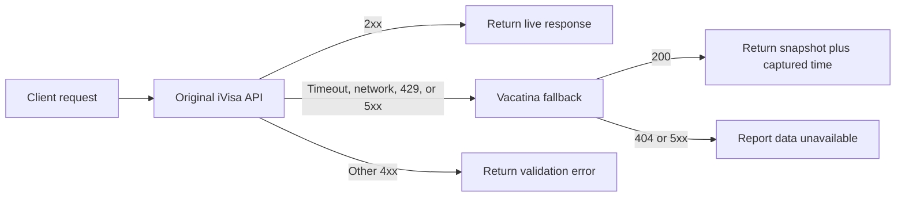

# Visa API Reference

This reference covers the Vacatina read-only fallback API and the two original iVisa endpoints whose successful response bodies it preserves.

> The iVisa section describes behavior observed during authorized testing in August 2026. It is not official iVisa API documentation, and undocumented behavior may change.

## Base URLs

| Service | Base URL |
|---|---|
| Vacatina fallback | `https://vacatina-visa-api.vercel.app` |
| Original iVisa | `https://www.ivisa.com` |

## Authentication

The current Vacatina deployment has no API key. If `API_KEY` is configured later, send either:

```http
X-API-Key: YOUR_API_KEY
```

or:

```http
Authorization: Bearer YOUR_API_KEY
```

The two observed iVisa endpoints accepted requests without an API key. This does not guarantee continued public availability or grant permission for automated use.

## Codes

- `nationality` is the traveler's passport country.
- `destination` is the country the traveler wants to enter.
- Countries use ISO 3166-1 alpha-2 codes such as `IN`, `AE`, `US`, and `GB`.
- The Vacatina API accepts lowercase country codes and normalizes them.
- Currency uses a three-letter code such as `USD`.

## Destination requirements

Returns the travel-document decision and divides known products into eligible and ineligible groups.

```http
GET /visa/destination-requirements/{nationality}/{destination}
```

### Vacatina request

```bash
curl 'https://vacatina-visa-api.vercel.app/visa/destination-requirements/IN/AE' \
  -H 'Accept: application/json' | jq
```

### Original iVisa request

```bash
curl 'https://www.ivisa.com/visa/destination-requirements/IN/AE' \
  -H 'Accept: application/json' | jq
```

### Successful response

```json
{
  "outcome": "visa_supported",
  "requires_document": true,
  "visa_required_to_enter_destination": true,
  "visas_available": true,
  "requirement_text": "The United Arab Emirates Tourist eVisa is mandatory for India passport holders traveling to United Arab Emirates.",
  "documents": {
    "eligible": [
      {
        "visa_type_id": 42,
        "product_id": 10139,
        "name": "United Arab Emirates Tourist eVisa",
        "classification": "evisa",
        "classification_group": "visa",
        "is_visa": true,
        "is_required": true,
        "requirement_phrase": "The United Arab Emirates Tourist eVisa is mandatory for India passport holders traveling to United Arab Emirates.",
        "validity": {
          "visa_validity": "60 days after issued",
          "num_entries": "Single entry",
          "max_stay": "30 days in total",
          "starts": "When Issued"
        },
        "reasons_for_travel": ["tourism"]
      }
    ],
    "ineligible": []
  }
}
```

### Observed outcomes

| Outcome | Interpretation |
|---|---|
| `visa_supported` | A document is required and at least one eligible product was captured. |
| `document_not_required` | The supplied passport does not require the destination product. |
| `document_unsupported` | A document is required, but iVisa did not offer an eligible product for this combination. |
| `other_document_supported` | A non-visa document, such as an arrival declaration, is available or recommended. |

### Main fields

| Field | Meaning |
|---|---|
| `outcome` | High-level requirement and product-availability state. |
| `requires_document` | Whether an additional travel document is required. |
| `visa_required_to_enter_destination` | Whether the captured rules say a visa is required. |
| `visas_available` | Whether an eligible visa product is available through iVisa. |
| `requirement_text` | Human-readable decision summary. |
| `documents.eligible` | Products applicable to this passport/destination pair. |
| `documents.ineligible` | Destination products not applicable to this passport holder. |
| `visa_type_id` | Variant identifier used to join to `options[].id`. |
| `product_id` | Broader product identifier; several variants can share it. |

Use this endpoint—not the product endpoint—as the eligibility decision source.

## Product details and prices

Returns destination product variants, validity, eligible nationalities, and captured fee fields.

```http
POST /product/reset-visa-type-names
Content-Type: application/json
```

### Request body

```json
{
  "global_fields": {
    "common_nationality_country": "IN"
  },
  "traveler_list": [[]],
  "primary_product_classification": "visa",
  "currency": "USD",
  "destination_country_code": "AE"
}
```

| Field | Required | Notes |
|---|---:|---|
| `global_fields.common_nationality_country` | Yes | Passport country code. |
| `traveler_list` | No | Preserved for compatibility; the fallback does not use it to choose a snapshot. |
| `primary_product_classification` | Yes | The fallback currently accepts only `visa`. |
| `currency` | Yes | Requested currency. Captured data may still contain USD. |
| `destination_country_code` | Yes | Destination country code. |

### Vacatina request

```bash
curl 'https://vacatina-visa-api.vercel.app/product/reset-visa-type-names' \
  -X POST \
  -H 'Accept: application/json' \
  -H 'Content-Type: application/json' \
  --data-raw '{
    "global_fields": { "common_nationality_country": "IN" },
    "traveler_list": [[]],
    "primary_product_classification": "visa",
    "currency": "USD",
    "destination_country_code": "AE"
  }' | jq
```

### Original iVisa request

```bash
curl 'https://www.ivisa.com/product/reset-visa-type-names' \
  -X POST \
  -H 'Accept: application/json' \
  -H 'Content-Type: application/json' \
  --data-raw '{
    "global_fields": { "common_nationality_country": "IN" },
    "traveler_list": [[]],
    "primary_product_classification": "visa",
    "currency": "USD",
    "destination_country_code": "AE"
  }' | jq
```

### Successful response

```json
{
  "options": [
    {
      "name": "United Arab Emirates Tourist eVisa - 60 days, Single entry",
      "value": "42",
      "show_if": {
        "field_name": "common_nationality_country",
        "condition": "in_list",
        "value": ["IN", "LK"]
      },
      "product_id": "10139",
      "eligible_nationalities": ["IN", "LK"],
      "product_name": "United Arab Emirates Tourist eVisa",
      "product_name_short": "eVisa",
      "unlisted": false,
      "validity": {
        "visa_validity_days": 60,
        "visa_validity": "60 days after issued",
        "num_entries": "Single entry",
        "max_stay": "30 days in total",
        "max_stay_short": "30 days",
        "passport_requirements": {
          "duration": 186,
          "unit": "days",
          "exp_type": "arrival"
        },
        "base_price": {
          "id": 3454,
          "price": "70.990",
          "currency": "USD",
          "min_price_usd": "0.01",
          "base_price_usd": "31.99",
          "sku": 3454
        },
        "gov_fee": "110"
      },
      "pricing": {
        "visa_cost": "110.00",
        "visa_cost_pretty": "$110.00",
        "name": "Government Fee",
        "price_append": "Pay To iVisa",
        "is_visa_cost_paid_later": false
      },
      "id": 42,
      "visa_classification": "evisa"
    }
  ]
}
```

The nationality arrays above are shortened for readability. Actual responses preserve the full captured arrays.

### Eligibility warning

The product endpoint is not eligibility-filtered. It can return a product even when the requested nationality is absent from `eligible_nationalities` and `show_if.value`.

Prefer this match:

```text
requirements.documents.eligible[].visa_type_id == products.options[].id
```

Alternatively, verify that the nationality is in `options[].eligible_nationalities`. IDs can be numbers in one response and strings in another, so normalize them before comparing.

## Pricing fields

Keep all price-like values separate.

| Field | Safe interpretation |
|---|---|
| `validity.base_price.price` | Captured iVisa base/service-price field. |
| `validity.base_price.currency` | Currency attached to that base price. |
| `validity.base_price.base_price_usd` | Additional internal USD pricing metadata. |
| `validity.base_price.min_price_usd` | Additional internal minimum-price metadata. |
| `validity.gov_fee` | Captured government-fee metadata. |
| `pricing.visa_cost` | Displayed visa/government-fee value. |
| `pricing.is_visa_cost_paid_later` | Whether the displayed visa cost is paid later. |

Do not assume that `base_price.price + gov_fee` equals the final checkout total. Processing speed, traveler count, add-ons, taxes, discounts, and other checkout rules are not represented here.

Testing also showed that an `EUR` request could still return a USD base price. Always read the response currency.

## Vacatina snapshot headers

Successful fallback responses add headers without changing the JSON body:

```http
X-Data-Source: ivisa-snapshot
X-Data-Captured-At: 2026-08-10T21:56:05.839Z
Cache-Control: private, max-age=300, stale-while-revalidate=3600
```

Use `X-Data-Captured-At` to show data age and decide whether a snapshot is acceptable.

## Health endpoint

The health endpoint exists only on Vacatina:

```http
GET /healthz
```

```bash
curl 'https://vacatina-visa-api.vercel.app/healthz' | jq
```

Healthy example:

```json
{
  "ok": true,
  "service": "vacatina-visa-api",
  "database": "connected",
  "latest_run": {
    "id": 1,
    "status": "completed"
  }
}
```

Run statuses include `running`, `completed`, `completed_with_errors`, and `interrupted`. `completed_with_errors` means some source jobs failed, so missing combinations can return `404`.

Database failure returns HTTP `503`:

```json
{
  "ok": false,
  "service": "vacatina-visa-api",
  "database": "unavailable"
}
```

## Errors

### Vacatina fallback

| Status | Situation |
|---:|---|
| `400` | Invalid JSON or unsupported product classification. |
| `401` | API key is configured and the request is unauthorized. |
| `404` | No captured snapshot exists for the exact combination. |
| `422` | Country or currency code is invalid. |
| `500` | Unexpected server or database query failure. |
| `503` | Health check cannot connect to the database. |

Example:

```json
{
  "error": true,
  "message": "Invalid country code"
}
```

### Observed original iVisa behavior

| Status | Observed situation |
|---:|---|
| `400` | Unsupported product classification, such as the tested `arrival_card` payload. |
| `422` | Invalid country code. |
| `429` | Possible rate limiting; honor `Retry-After` when present. |
| `5xx` | Temporary upstream failure. |

## Recommended fallback flow

Use iVisa first when live data is required. Fall back for network failures, timeouts, HTTP `429`, or HTTP `5xx`. Do not replace meaningful iVisa validation errors with cached data.



### TypeScript example

```ts
const IVISA_BASE_URL = "https://www.ivisa.com";
const FALLBACK_BASE_URL = "https://vacatina-visa-api.vercel.app";

async function fetchWithVisaFallback(path: string, init?: RequestInit) {
  try {
    const live = await fetch(`${IVISA_BASE_URL}${path}`, {
      ...init,
      signal: AbortSignal.timeout(8_000),
    });

    const meaningfulClientError =
      live.status >= 400 && live.status < 500 && live.status !== 429;
    if (live.ok || meaningfulClientError) return live;
  } catch {
    // Network failure or timeout: use the snapshot below.
  }

  return fetch(`${FALLBACK_BASE_URL}${path}`, {
    ...init,
    signal: AbortSignal.timeout(8_000),
  });
}
```

When authentication is enabled, add `X-API-Key` server-side. Never expose a private API key in browser code.

## Service differences

| Behavior | Original iVisa | Vacatina fallback |
|---|---|---|
| Data | Live upstream response | Latest captured database snapshot |
| Successful JSON body | Source format | Stored source body returned unchanged |
| Snapshot timestamp | Not exposed by these endpoints | `X-Data-Captured-At` |
| Health endpoint | Not observed | `/healthz` |
| Missing combination | Upstream-dependent | HTTP `404` |
| Authentication | No key observed | Optional `API_KEY` |
| Currency | Upstream-dependent | Currency stored in the snapshot |
| Product classification | Upstream-dependent | Captured `visa` shape only |

## Operational caveats

- Visa requirements and prices can change without notice.
- The fallback is a timestamped snapshot, not an authoritative immigration decision.
- A completed collection can still have failed jobs; inspect `/healthz` and collector job counts.
- A product response does not prove eligibility. Evaluate the requirements response first.
- The fallback does not call iVisa when a record is missing.
- The current public fallback has no API key, so anyone can consume Vercel and Neon resources.
